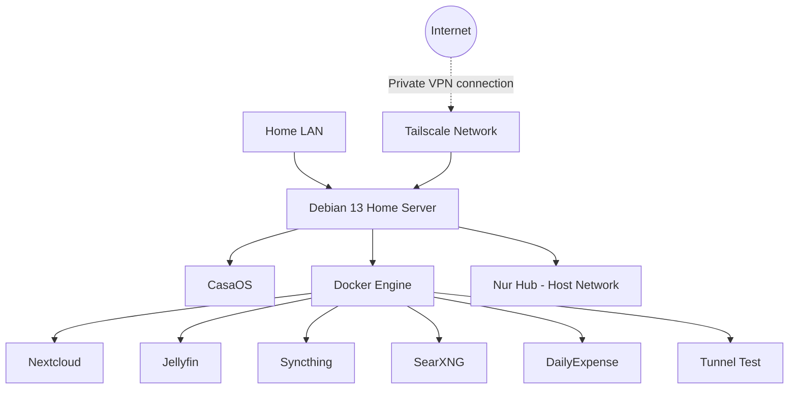

# Server Architecture

## 1. Overview

The home server runs Debian GNU/Linux 13 and uses CasaOS and Docker to manage self-hosted applications.

Remote access is provided through Tailscale. Services are intended to remain accessible only through the local network or the private Tailscale network.

## 2. Architecture Diagram

## 3. Network Design

- **Home LAN:** Local access to selected services.
- **Tailscale:** Private remote access.
- **Docker bridge networks:** Container-to-container communication.
- **Localhost bindings:** Used for selected applications that should not be directly exposed on the LAN.

## 4. Services

| Service | Network Mode / Access |
|---|---|
| Nextcloud | Docker bridge |
| Jellyfin | Docker bridge |
| Syncthing | Docker bridge |
| SearXNG | Docker bridge |
| DailyExpense | Localhost binding |
| Tunnel Test | Localhost binding |
| Nur Hub | Host networking |

## 5. Security Boundaries

- UFW controls host-level incoming traffic.
- Docker `DOCKER-USER` rules restrict selected published ports.
- SSH is restricted to the LAN and Tailscale.
- Docker firewall rules have not yet been made persistent.
- External IPv4 and IPv6 access restrictions still require verification.

## 6. Operational Notes

- The server is configured to remain running when the laptop lid is closed.
- Backups are not yet configured.
- Firewall persistence and restore testing remain planned tasks.